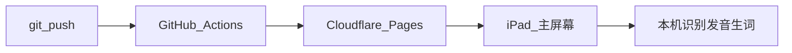

# 儿童英语点读 · 个人版

日期：2026-11-09
状态：当前唯一有效的产品与技术决策。
范围：一个孩子、一台 iPad。家长用 git 更新代码和词义。

[kids-english-app-plan-v2.md](kids-english-app-plan-v2.md) 与 [kids-english-app-tech-design-v1.md](kids-english-app-tech-design-v1.md) 里的产品级决策（多用户、CloudBase、三套环境、跟读打分）由本文取代。两份旧文保留。OCR 实测数字仍以旧文和技术注释为准，下文只列指针，不改数字。

实现顺序与每一期验收见 [docs/superpowers/plans/2026-11-09-personal-ipad.md](docs/superpowers/plans/2026-11-09-personal-ipad.md)。

---

## 使用范围

- 使用者是一个孩子，设备是一台 iPad，浏览器是 Safari，入口是主屏幕图标。
- 上课时家长的电脑保持关机。应用是已经构建好的静态网页。
- 家长改代码或词义时提交 git。推送之后，iPad 下次打开即可换成新版本。

## 运行与更新

- 站点由 GitHub Actions 执行仓库根目录的 `npm run build`，Cloudflare Pages 发布 `apps/web/dist`。
- 主屏幕里的页面发现新版本时，提示「点一下更新」，由孩子或家长确认后再换上。
- 词义文件和代码走同一条 git 路径。小改可以在 iPad 上用 Working Copy 提交；大改在电脑上做。电脑只在修改时使用，不参与上课。

## 本机闭环

拍照或从相册选图，接着走现有预处理、端侧 Tesseract、英文词库、点词、系统语音、已审阅释义、生词本。

| 环节 | 位置 |
|---|---|
| OCR 引擎与本地模型 | [apps/web/public/tesseract](apps/web/public/tesseract)，加载逻辑在 [apps/web/src/platform/web/ocr/tesseract-engine.ts](apps/web/src/platform/web/ocr/tesseract-engine.ts) |
| 英文词库 | [apps/web/public/lexicon/en-words.txt.gz](apps/web/public/lexicon/en-words.txt.gz) |
| 预处理与识别实验台 | [apps/web/src/features/ocr-lab/OcrLab.tsx](apps/web/src/features/ocr-lab/OcrLab.tsx) |

照片、录音、生词和复习进度写在这台 iPad 的 IndexedDB。备份是导出一份 JSON，需要时再导回。没有账号，没有云同步。

`apps/web/src/domain/` 保持纯函数，不引用 `platform/`。

## 发音与释义

发音沿用 [apps/web/src/platform/core/classify.ts](apps/web/src/platform/core/classify.ts) 的 `isTrusted`：词库命中才发音。词库外的词不提供发音按钮。

释义只来自仓库里的 `content/words.json`，字段为 `word`、`meaning`、`example`。家长审过再提交。点词时若没有对应条目，词卡写「还没有释义」。

系统语音使用 `speechSynthesis`，英文语音，用 `rate` 放慢。同一时间只读一个词。

## 生词、复习与跟读

- 生词存在本机 IndexedDB。
- 复习间隔沿用技术设计 5.8 节：`stage` 从 0 到 5，间隔为 `[0, 1, 3, 7, 16, 35]` 天。每天最多复习 20 个词。
- 跟读是听一遍、自己读、再听自己的录音。录音留在本机。

## 云端

日常点读不调用外部接口。

[apps/web/vite.config.ts](apps/web/vite.config.ts) 里的 DeepSeek 代转只在 `npm run dev` 时生效，密钥留在已被忽略的 `.env.local`。生产站点不包含 `/api/vlm-review`。识别实验台上的「云端语义复核」在生产构建里默认关闭。现在 [OcrLab.tsx](apps/web/src/features/ocr-lab/OcrLab.tsx) 中 `reviewEnabled` 的初始值是 `true`，部署到 Pages 之前要改成生产默认关闭。

以后若要在 iPad 上复核难页，单独增加 Cloudflare Worker：密钥放在 Worker 的环境变量，iPad 上的开关默认关闭。

## 费用

- Cloudflare Pages 与 GitHub Actions：0。
- 日常点读的 API：0。识别、词库、发音、生词都在 iPad 上完成。
- 只有家长打开云端复核时，才按 DeepSeek 的实际调用计费。一个人、几十页的用量通常是几元一个月。

## 明确不做

下列能力留在旧文档里，个人版不排期：CloudBase、Capacitor 壳、腾讯云 OCR / TTS / ASR、内容管理后台、开发与正式分环境、3000 词真人录音、跟读打分、家长周报、教材同步包。

某本真实课本在 Safari 里识不准时，再针对那几页单独立项。

## 仍沿用的实测结论

数字与取舍不在本文改写，实现时打开原处：

- Tesseract 置信度未校准，高置信阈值 `0.70`。见技术设计「置信度归一化」一节，以及 [classify.ts](apps/web/src/platform/core/classify.ts) 里的 `CONFIDENCE_THRESHOLDS`。
- 云端复核不要求坐标框。框的用途已在 [vite.config.ts](apps/web/vite.config.ts) 的提示词注释里说明。复核图长边为 `1600`，常量是 [client.ts](apps/web/src/platform/web/vlm/client.ts) 的 `REVIEW_MAX_EDGE`。
- OCR 与词库从 `import.meta.env.BASE_URL` 下的本地文件加载，不请求境外 CDN。见 [tesseract-engine.ts](apps/web/src/platform/web/ocr/tesseract-engine.ts)。
